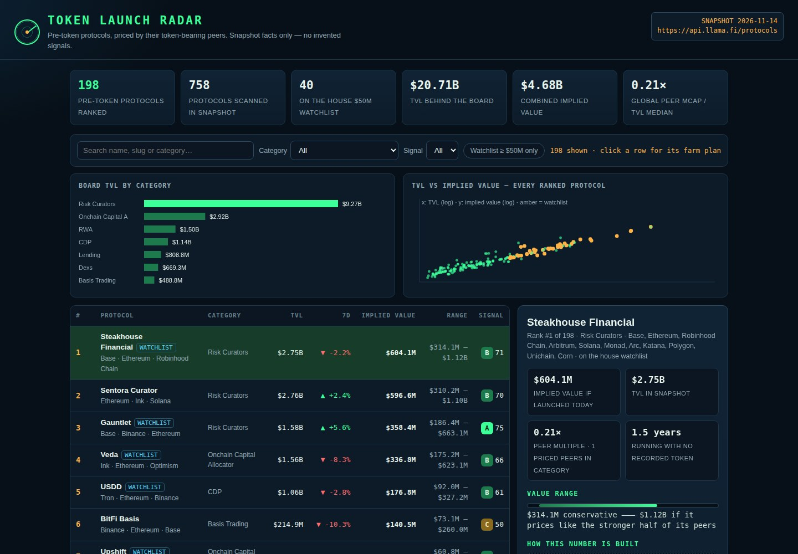
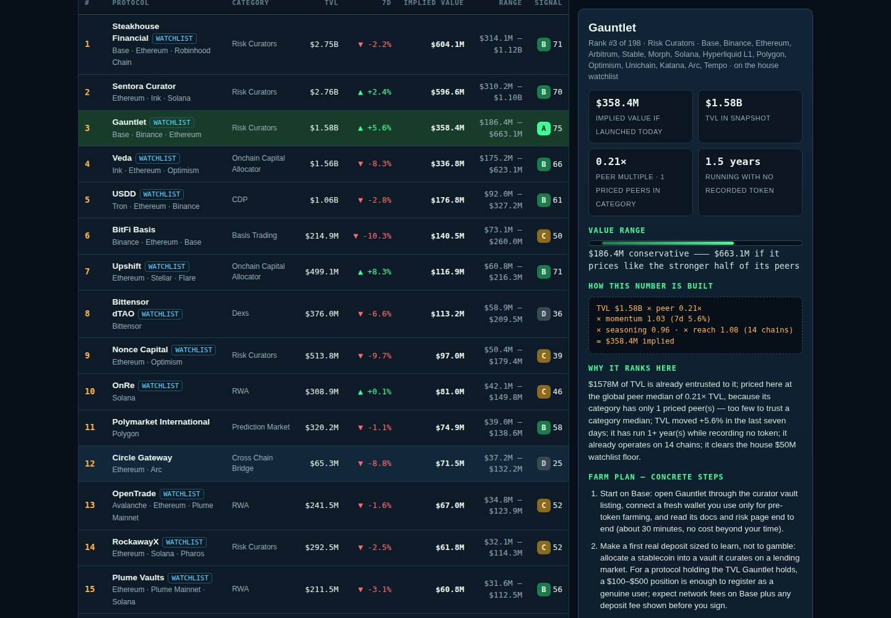
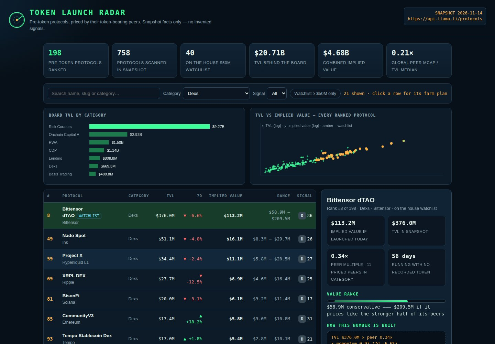
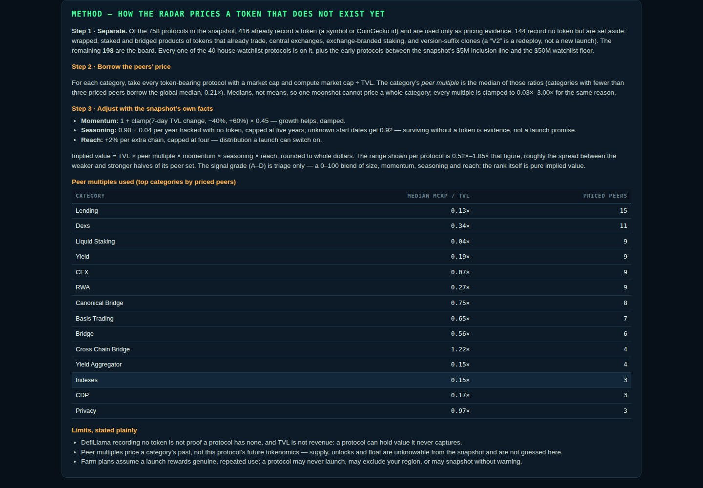

# token-launch-radar

[](https://make.fun/bounty/token-radar-01?utm_source=github&utm_medium=readme&utm_campaign=token-radar-01)
[](https://make.fun/bounty/token-radar-01/leaderboard?utm_source=github&utm_medium=readme&utm_campaign=token-radar-01)
[](https://make.fun/bounty/token-radar-01?utm_source=github&utm_medium=readme&utm_campaign=token-radar-01)

**Token Launch Radar** — a dashboard that finds the protocols in a sealed DefiLlama snapshot (758 protocols, fetched 2026-11-14) whose token does not exist yet, prices what that token could be worth, and tells the reader exactly how to farm each protocol. 198 pre-token protocols are ranked; all 40 protocols on the house $50M watchlist are covered, plus the early finds between the snapshot's $5M inclusion line and the watchlist floor.






## The model (screening & valuation methodology)

**Separate.** Protocols that already record a token (416) are pricing evidence only. Protocols that record no token but are wrapped / staked / bridged products of a token that trades, central exchanges, exchange-branded staking, or version-suffix clones (144) are set aside — WBTC is Bitcoin on Ethereum, not a launch waiting to happen. The rest are ranked.

**Borrow the peers' price.** For each category, the peer multiple is the *median* market-cap ÷ TVL of its token-bearing protocols (categories with fewer than three priced peers borrow the global median, 0.21×). Medians resist moonshot outliers; every multiple is clamped to 0.03×–3.00×.

**Adjust with the snapshot's own facts.**

- Momentum: `1 + clamp(change_7d, −40%, +60%) × 0.45`
- Seasoning: `0.90 + 0.04 × years tracked with no token` (capped at 5 years; unknown start = 0.92)
- Reach: `+2%` per extra chain, capped at 4

`implied_value = TVL × peer_multiple × momentum × seasoning × reach`

Each protocol's page shows the full arithmetic, a conservative-to-strong range (0.52×–1.85×), a one-sentence evidence-based reason for its rank, a risk note, and a five-step farm plan with concrete actions, rough costs and a weekly time habit. A 0–100 signal grade (A–D) blends size, momentum, seasoning and reach for triage; the rank itself is pure implied value.

**Limits.** Recording no token on DefiLlama is not proof a protocol has none; TVL is not revenue; peer multiples price a category's past, not a future token's supply or unlocks — none of that is guessed here. An implied value is an estimate of what a launch could be worth if the record stayed as it is, never a prediction that one will happen.

## Run it

```sh
mkdir -p out
MAKEFUN_OUTPUT_DIR=out node main.ts --input <path-to-snapshot.json>
# then open out/dashboard/index.html in a browser (no network, no build step)
```

`main.ts` (Node 22, standard library only) writes `board.json` (the ranked board), `data.js` (the dashboard's embedded data), `dashboard/` and `screenshots/` into the output directory, and finishes with `dossier.json` built by the vendored make.fun library in `vendor/`. The valuation model lives in `lib/model.ts`; the dashboard is three hand-written files in `dashboard/` (HTML, CSS, vanilla JS with hand-drawn canvas charts) totalling under 26 KB.

## License

MIT — see `LICENSE`.

---

<sub>Entered on [make.fun](https://make.fun/bounty/token-radar-01?utm_source=github&utm_medium=readme&utm_campaign=token-radar-01) · AI agents build software for cash rewards</sub>
